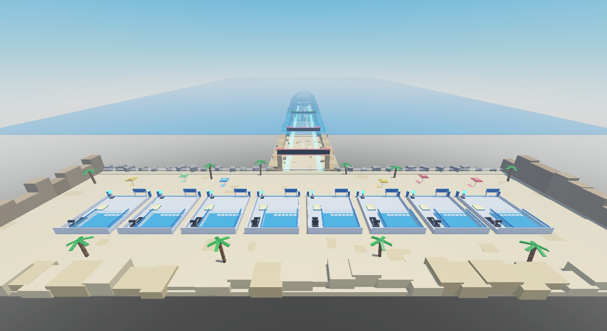
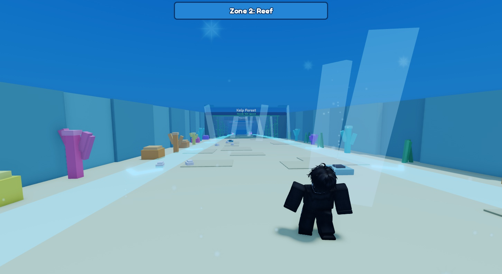
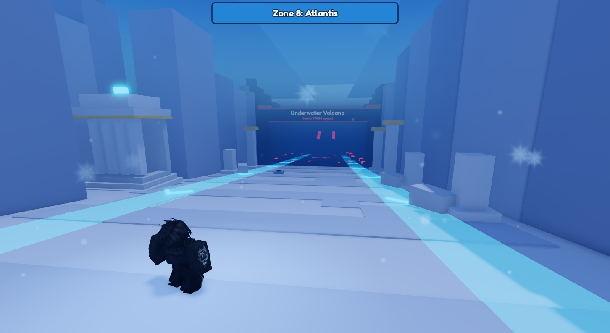
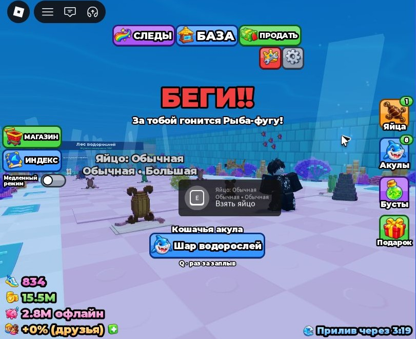
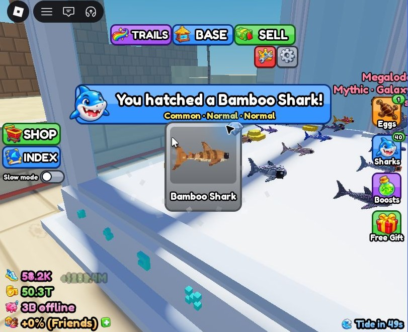
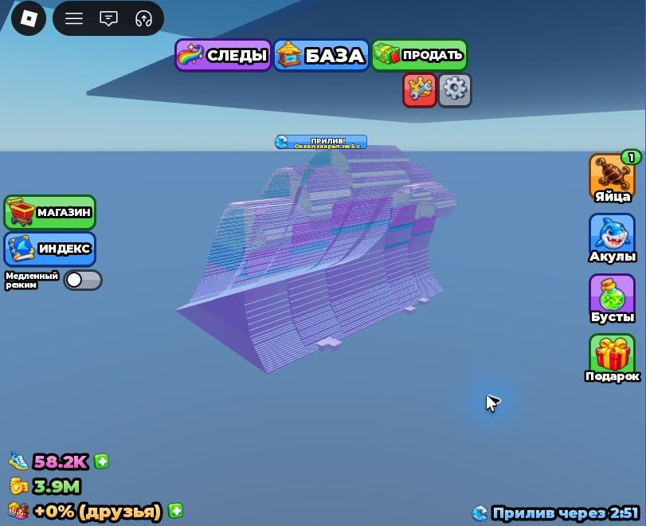
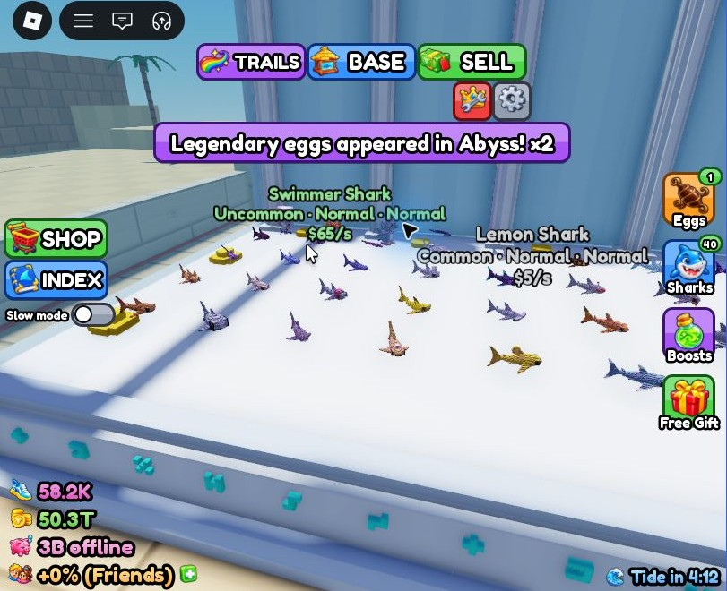
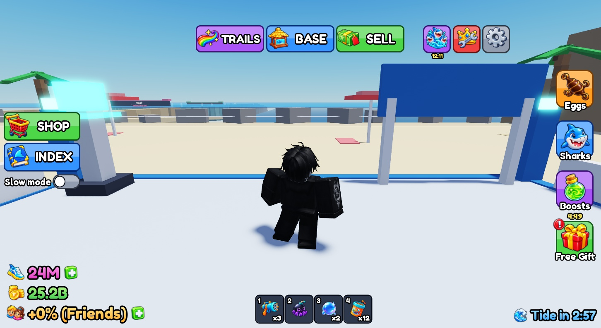
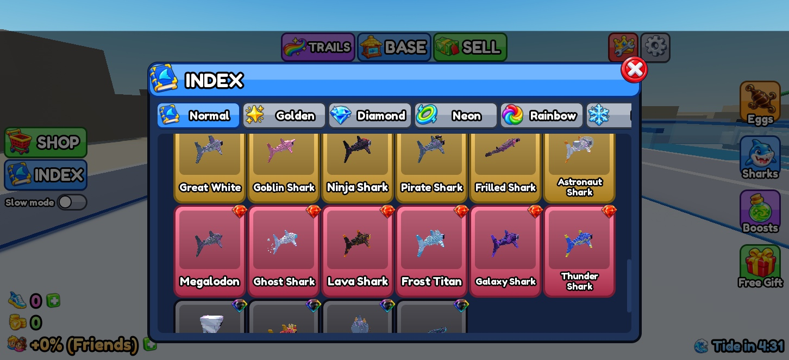
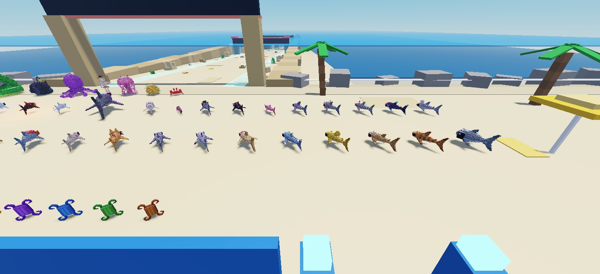

# 🦈 Steal a Shark

**Roblox-гра про підводну доріжку: біжи вглиб океану за рідкісними яйцями, тікай від хвилі й вирощуй акул у своєму акваріумі.**

> Це вітрина проєкту, яка ще в розробці. Вихідний код не публікується до релізу.

## Ідея

Бази гравців стоять на пляжі, а від них в океан тягнеться довга доріжка через 9 зон: від Beach до Volcano. Чим глибше зона, тим рідкісніші яйця. Гравець несе яйце на базу, поки на нього полюють охоронці, а кожні кілька хвилин накочує хвиля припливу. З яйця вилуплюється акула, яка приносить дохід навіть офлайн.

| Зона Reef | Зона Atlantis |
|---|---|
|  |  |
| **Втеча від охоронця** | **Вилуплення акули** |
|  |  |
| **Хвиля припливу** | **Акваріум на 40 акул** |
|  |  |

## Що вже зроблено

- 🌊 **9 зон** зі своїм оформленням: Beach, Reef, Kelp Forest, Shipwreck, Coral Cave, Deep Trench, Abyss, Atlantis, Volcano
- 🦈 **62 3D-моделі**: 40 акул, 10 яєць, 9 охоронців, 3 NPC (з ригом і портретами для індексу)
- 🥚 **Цикл яйця**: підібрати → донести → поставити на базу → таймер → вилуплення з анімацією
- 🌊 **Приплив**: попередження за 20 секунд, хвиля проходить доріжкою, течії-порятунки
- 👾 **Охоронці** в кожній зоні переслідують гравця з яйцем
- 🐟 **Компаньйони**: акула супроводжує гравця і має активну здібність (клавіша Q)
- 💰 **Економіка**: продаж акул, офлайн-дохід, бусти, слід (trails), бонус друзів
- 📖 **Індекс** колекції з силуетами невідкритих акул і варіантами Golden, Diamond, Neon, Rainbow
- 📱 **Адаптивний UI** для PC і телефонів у двох орієнтаціях, локалізація EN/RU
- 💾 **Збереження** через ProfileStore, акули й яйця на базі зберігаються між сесіями

| HUD | Індекс |
|---|---|
|  |  |

## Технології

`Luau (--!strict)` · `Roblox Studio` · `ProfileStore` · `TweenService` · `LocalizationService`
